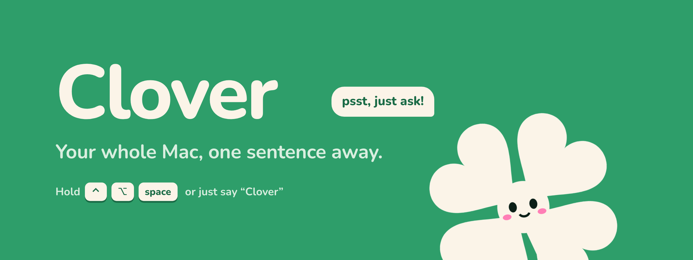

<p align="center"></p>

<p align="center">
  Hold <kbd>⌃ control</kbd> <kbd>⌥ option</kbd> <kbd>space</kbd> and talk, or just say <b>“Clover”</b>.<br>
  Clover moves your windows, finds your files, reads your screen, draws to explain, and gets it done.
</p>

<p align="center">
  <b>Clover is a free, open-source AI voice assistant for macOS.</b> Talk to your Mac, point at your screen, and let it do the work:<br>
  window management, file search, screen reading, dictation, background agents and hands-free chat, on Claude, Antigravity, OpenAI, Gemini, Azure or a local model.
</p>

<p align="center">
  <a href="https://github.com/joinhackyard/clover/actions/workflows/ci.yml"></a>
  <a href="https://github.com/joinhackyard/clover/releases/latest"></a>
  
  
  <a href="LICENSE"></a>
  <a href="https://github.com/joinhackyard/clover/stargazers"></a>
</p>

## Quick install

```bash
curl -fsSL https://raw.githubusercontent.com/joinhackyard/clover/main/install.sh | bash
```

Needs macOS 26 and one AI: Claude Code on your Claude plan (the default), **Antigravity** on your Google plan, **your own API key** (Claude, OpenAI, Gemini, Azure OpenAI, OpenRouter, Groq, Mistral, DeepSeek, xAI) or a local model with Ollama. Or grab the ready-made app from [Releases](https://github.com/joinhackyard/clover/releases/latest). [Full install steps](#install)

## What it does

- **Hands-free.** Say “Clover” (or your own wake word), ask, and keep talking after each answer. Clover reads answers aloud, chimes when it’s your turn, and understands **voice commands**: “stop”, “copy that”, “say that again”, “be quiet”, “thanks Clover”.
- **Any AI.** Claude Code or Antigravity on the plan you already pay for, no extra keys or logins. Or bring your own key for Claude, OpenAI, Gemini, Azure OpenAI, OpenRouter, Groq, Mistral, DeepSeek or xAI, run locally with Ollama, or point it at any endpoint. Test the connection and pick models right in Settings.
- **Learns.** Ask for something new once and it works out the steps. Ask again and it runs in a blink, with no AI.
- **Instant commands.** Opens apps, moves windows, plays music and searches the web with no AI at all.
- **Sees your screen.** Ask about anything on screen. Ask “where do I click?” and it points at the spot.
- **Draws to explain.** “Explain this and draw it” builds a labeled diagram on your screen, step by step.
- **Interactive answers.** Code blocks with copy buttons, link chips, tables and math, plus Copy · Read aloud · Follow up under every answer.
- **Mac gestures.** Two-finger swipe the box away, pinch it small while Clover works, pinch out to bring it back. Springy, Reduce Motion aware.
- **Cute sounds.** Clover’s own little sound pack (Pip, Hop, Bloom, Hush, Chirp), or classic Mac sounds, or silence.
- **Dictate anywhere.** Hold fn, talk, let go. Your words land in any text field, cleaned up.
- **Background agents.** Big jobs run behind your apps while you keep working.
- **Meeting Copilot.** Answers and notes during calls, saved on your Mac.
- **Remembers you.** Say “remember…” and every ask after that knows it.
- **You choose how much it asks.** *Ask first*, *Auto* (asks only before deleting or buying) or *Bypass permissions*. Your voice stays on your Mac. No telemetry.

## Just ask

| You say | Clover |
|---|---|
| *“Code on my big screen, Chrome and Terminal on the laptop.”* | Arranges three windows across two displays. |
| *“Open Spotify.”* · *“Terminal on the left.”* | Runs instantly, with no AI at all. |
| *“Find my notes about the Tokyo trip.”* | Searches your files by what’s inside them and opens the match on your other screen. |
| *“What’s wrong with this code?”* | Looks at your screen and answers in a line. |
| *“Reply to this. Thursday works, send me a time.”* | Reads the email on screen and writes the reply. Insert puts it at your cursor. It never sends. |
| *“Move my dentist appointment to 4.”* | Shows the old and new time on a card and moves it when you approve. Adding is immediate; moving or deleting asks first. |
| *“Find me a desk lamp under $30 on Amazon.”* | Works in Chrome behind your apps; a live mini screen shows it. |
| *“Where do I turn on Night Shift?”* | A ring lights up the exact spot on your screen. |
| *“Play my late night coding playlist.”* | Plays it in a second, no clicks. |
| *“When I say focus mode, close Slack and open my to-do list.”* | Remembers it. Next time, two words do it all. |

## Hands-free

Turn on **Wake word** in Settings → General → Hands-free (off by default). The word is “Clover” unless you type your own. Say it, with or without “hey” first; a little chirp means Clover is listening. Speech is recognized on your Mac only.

After each answer Clover listens again. In hands-free chats it reads answers aloud (Settings → **Read answers aloud in hands-free chats**) and plays a soft chime when it’s your turn. Clicking other apps never closes a hands-free chat. While the wake word is on, macOS shows the orange mic dot.

**Voice commands** (Settings → Hands-free → Voice commands) never reach the AI:

| Say | Clover |
|---|---|
| “stop”, “cancel”, “that’s all”, “thanks Clover”, “bye” | Ends the hands-free chat |
| “copy that” | Copies the last answer |
| “say that again”, “repeat that” | Reads the last answer again |
| “be quiet”, “shush” | Stops talking and stops listening until you say “Clover” |

## Bring your own AI

Settings → Intelligence → **AI provider**:

| Provider | What you enter | Notes |
|---|---|---|
| **Claude Code** (default) | Nothing: your Claude plan sign-in | Background agents, connectors and routines run here. |
| **Antigravity** | Nothing: your Antigravity (Google) sign-in | Runs the `agy` CLI headless on your existing plan. Clover’s safety gate is installed as its `PreToolUse` hook; if Antigravity doesn’t load the hook, Clover only lets it answer, never act. Optional model override. |
| **API key → Claude API** | Anthropic key | Defaults: `claude-haiku-5-5` fast, `claude-sonnet-5-5` for real work. Uses prompt caching. |
| **API key → OpenAI** | OpenAI key (base URL optional) | Defaults: `gpt-5-mini` fast, `gpt-5` for work. **Load models** lists your chat models. |
| **API key → Azure OpenAI** | Endpoint, key, deployment (+ optional work deployment), API version | Classic `…/openai/deployments/<name>` URLs, or `v1` for the Azure AI Foundry v1 API. |
| **API key → Google Gemini** | Gemini API key | `gemini-3.5-flash` fast, `gemini-3.1-pro` for work. |
| **API key → OpenRouter · Groq · Mistral · DeepSeek · xAI** | That service’s key | Sensible fast/work defaults; change them or load the model list. |
| **API key → Ollama** | Nothing (local) | Talks to `http://localhost:11434/v1`; pick a model you’ve pulled. |
| **API key → Custom** | Base URL, optional key, model, format | Any OpenAI-compatible chat completions server (LM Studio, vLLM, Together…) or Anthropic Messages. |

**Test connection** makes one tiny real call and tells you what’s wrong (bad key, wrong deployment, unreachable). With an API key, Clover runs its own tool loop: the model gets a `bash` tool and a `read_file` tool (screenshots come back as images), and every call goes through the same safety gate as Claude Code. **Cheapest** keeps every ask on the fast model, **Balanced** moves long jobs to the work model, **Most capable** always uses the work model. Meeting Copilot, meeting summaries and dictation clean-up use your key too. Keys stay in `~/.config/clover/settings.json` (mode 0600) and only go to the provider you chose.

## Permissions

Settings → Account & Access → **Safety** has three modes:

| Mode | What Clover does |
|---|---|
| **Ask first** (default) | Shows an Allow card before anything deletes, sends, buys, runs a program or changes a file. |
| **Auto** | Acts on its own and only asks before deleting or buying. |
| **Bypass permissions** | Never asks. |

In every mode, for every AI provider, `rm`, `sudo`, disk tools, shutdown and `git push` stay blocked. Every exact command is in the ask log. Apple’s on-device speech turns your voice into text, and audio never leaves your Mac.

<details>
<summary><b>How the shortcut, the box and the gestures work</b></summary>
<br>

Choose **Hold to talk** or **Press to toggle** in Settings → General → Shortcut behavior. Hold mode sends when you release. Toggle mode starts on the first press and sends on the second. Pressing the shortcut while Clover answers stops it; during spoken playback it stops the voice. Esc cancels listening without sending.

Click any answer to copy it. Click your request to edit and ask again, or press ↑ in an empty typing box to recall the latest request. While Clover works in a covered window, another Space, or another display, a live mini screen shows that window.

**Gestures** (Settings → General → Gestures): swipe two fingers sideways on the box and it follows your fingers, then flies away past the threshold or springs back. Pinch in to tuck it into the small bar with its live steps; pinch out to bring it back. Swipe down on a card to dismiss it. Everything respects Reduce Motion.

</details>

## Dictate anywhere

Hold fn to talk, let go to insert. Double-tap to lock it on. **Verbatim** types Apple’s on-device transcript with no AI. **Clean up** makes one quick AI pass that keeps your words, fixes what it clearly misheard, drops the “um”s, honours “scratch that”, and turns “new line” into formatting. It never answers or acts on what you dictate. For other languages pick **Whisper** in Settings → General → Speech model; it runs [whisper.cpp](https://github.com/ggml-org/whisper.cpp) on your Mac.

## Point at your screen · Draw on screen

Click **Point at your screen** next to the mic, then click, circle or scribble on anything and ask about it. The other way around, ask “where do I…?” or “explain this and draw it” and Clover draws boxes, arrows and labels over your screen, one step at a time, like a whiteboard.

## Agents, routines and watching

Ask for something big (“find me USB-C hubs”) and Clover hands it to a background agent while you keep working; a chip shows its live steps. Say “every weekday at 8, summarize my calendar” for a routine, or “tell me when the build is done” to watch a window with no AI while it waits. Agents and routines run on Claude Code.

## Meeting Copilot

Enable it in Settings → Meetings. Live answers during calls, local transcripts under `~/.config/clover/meetings/`, and an AI recap afterwards (or a fully local one if you turn AI summaries off).

## Install

You need:
- **macOS 26** or later (Clover uses Apple’s new on-device speech)
- **One AI:** [Claude Code](https://claude.com/claude-code) on a Claude Pro/Max plan, **or** the [Antigravity CLI](https://github.com/google-antigravity/antigravity-cli) signed in to your Google account, **or** an API key for any provider above, **or** [Ollama](https://ollama.com)
- Apple’s command line tools: `xcode-select --install`

```bash
curl -fsSL https://raw.githubusercontent.com/joinhackyard/clover/main/install.sh | bash
```

It checks your Mac, downloads Clover to `~/.clover`, builds `~/Applications/Clover.app`, and opens it. Clover starts at login and updates itself (turn that off in Settings → About & Updates). The first launch opens a setup window that checks your AI and walks through each macOS permission.

### Download the app

Every tagged version is built by CI and attached to [Releases](https://github.com/joinhackyard/clover/releases/latest) as `Clover-vX.Y.Z-macOS.zip` with its SHA-256. The build is signed ad hoc, not notarized, so after unzipping into `~/Applications` run `xattr -dr com.apple.quarantine ~/Applications/Clover.app` once (or right-click → Open). The install script above builds the same app on your Mac and keeps it updated.

### Nix

```bash
nix run github:joinhackyard/clover
```

Run it again to update. Nix installations show this update path in Settings instead of using Clover's Git updater.

### Build from source

```bash
git clone https://github.com/joinhackyard/clover.git && cd clover && ./build.sh
```

Remove: `launchctl bootout gui/$(id -u)/org.hackyard.clover`, then delete `~/Applications/Clover.app`, `~/.clover`, `~/.config/clover` and `~/Library/LaunchAgents/org.hackyard.clover.plist`.

## Develop

```bash
python3 -m unittest discover -s tests
```

Offline regressions for the brain, the provider engine (against mock Claude/OpenAI/Azure servers) and the pages. For UI checks run `python3 -m http.server 8765 --bind 127.0.0.1` and open `http://127.0.0.1:8765/tests/ui.html` or `tests/settings.html`: they use a mock native bridge and make no Mac actions or AI calls. CI also compiles the app on macOS 26.

- `Clover.swift` — the app: hotkey, wake word, speech, overlay, sounds, gestures bridge, windows
- `clover.py` — the brain: instant commands, system prompt, helpers for windows, web and screen, the safety gate
- `clover_engine.py` — Clover’s own model engine for API keys (Claude, OpenAI, Azure, custom)
- `ui/` — the overlay, setup, Settings, agents and meeting pages; `ui/orbs.js` the Clover orb and answer renderer; `ui/sounds/` the sound pack
- `scripts/make_sounds.py`, `scripts/make_art.py` — the sounds and the icon/banner are generated from code

## Budget

Instant commands cost nothing. AI asks aim for a median under $0.002 and 6 s (check with `python3 clover.py --budget`). The system prompt stays under 10,000 characters, enforced by tests. Anything that waits runs with no AI until it has to act.

## Privacy

Clover sends nothing anywhere except to the AI you chose. Anonymous usage counts are off unless a build sets `CLOVER_POSTHOG_KEY`.

## License

MIT © Hackyard. See `LICENSE`, and `THIRD_PARTY_NOTICES.md` for the small pieces that keep their own MIT notices.

<p align="center">Made with 💚 by <a href="https://hackyard.org">Hackyard</a></p>
